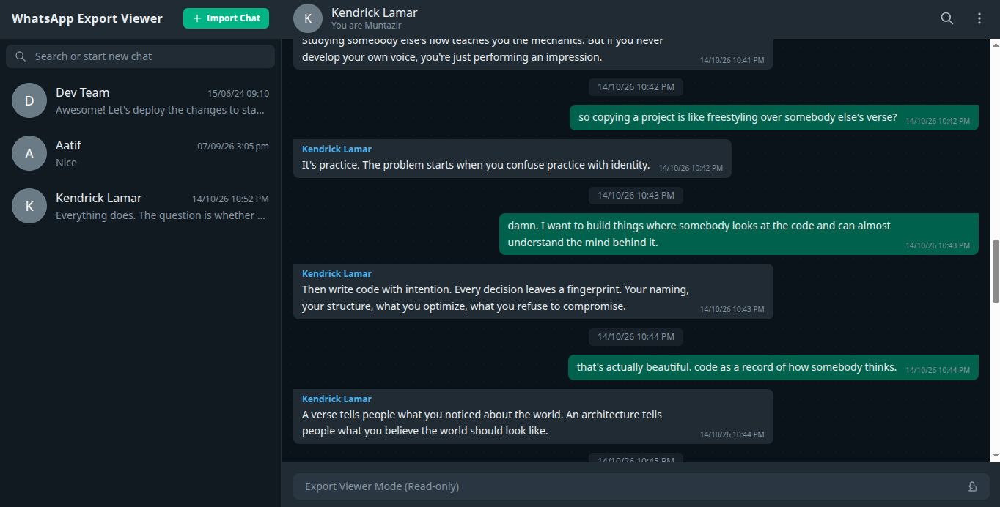

<p align="center">
  
</p>

<h1 align="center">WhatsApp Export Viewer</h1>

<p align="center">
  A cross-platform desktop application designed to import, parse, store, and view exported WhatsApp conversations in an interface faithful to WhatsApp Web. Built with Electron, React, Tailwind CSS, and SQLite.
</p>

<p align="center">
  
  
  
  
  
  
</p>

---

<p align="center">
  <!-- Replace this placeholder with an actual screenshot of the application -->
  
</p>

---

## Table of Contents

- [Overview](#overview)
- [Key Features](#key-features)
- [Architecture & Design](#architecture--design)
- [Technology Stack](#technology-stack)
- [Project Structure](#project-structure)
- [Missing Features & Planned Roadmap](#missing-features--planned-roadmap)
- [Getting Started](#getting-started)
  - [Prerequisites](#prerequisites)
  - [Installation](#installation)
  - [Development Mode](#development-mode)
  - [Building for Production](#building-for-production)
- [Database Schema & Persistence](#database-schema--persistence)
- [Contributing](#contributing)
  - [Branching Model](#branching-model)
  - [Coding Standards](#coding-standards)
  - [Pull Request Process](#pull-request-process)
- [Troubleshooting & FAQ](#troubleshooting--faq)
- [License & Author](#license--author)

---

## Overview

WhatsApp allows users to export individual and group chat logs as plain `.txt` files or bundled `.zip` archives containing media. However, reading thousands of raw text lines in a standard text editor is inconvenient and loses the conversational context, layout, and visual flow.

**WhatsApp Export Viewer** solves this by providing a local-first, offline desktop environment that parses raw chat logs and reconstructs them into an authentic, searchable, and responsive WhatsApp Web-style interface. All data remains completely on your local machine, stored inside a local SQLite database with zero telemetry, zero external network requests, and zero cloud lock-in.

---

## Key Features

### Local, Privacy-First Storage
- **100% Offline**: Operates without any internet connection. Chat exports never leave your device.
- **Embedded Database**: Utilizes `better-sqlite3` to persist chats, participants, and messages on disk with transactional reliability and cascading foreign key integrity.

### Universal Export Parsing (ETL Pipeline)
- **Multi-Format Ingestion**: Supports direct import of raw `.txt` files as well as compressed `.zip` export archives.
- **Cross-Platform Timestamp Normalization**: Handles diverse WhatsApp date-time conventions across Android (e.g., `DD/MM/YY, HH:MM - Sender: Message`) and iOS (e.g., `[DD/MM/YY, HH:MM:SS PM] Sender: Message`).
- **Unicode Sanitization**: Automatically strips invisible directional formatting marks (Left-to-Right `\u200e`, Right-to-Left `\u200f`, Byte Order Marks `\ufeff`, and narrow non-breaking spaces) commonly embedded by mobile export routines.
- **Memory-Efficient Streaming**: Employs Node.js stream readers and line buffers to parse large export files line-by-line without overloading system memory.
- **Transactional Batch Insertion**: Commits messages in batches of 1,000 using SQLite transactions, ensuring rapid ingestion even for conversations containing tens of thousands of messages.

### Import Conflict Resolution
- **Duplicate Collision Detection**: Pre-checks chat names against the local database prior to writing.
- **Resolution Dialog**: If a chat with the same contact or group name already exists, the app prompts you with options to keep the existing version or import the new file under a custom assigned name.

### WhatsApp Web User Interface
- **Authentic Visual Language**: Styled using Tailwind CSS v4 in dark mode to mirror WhatsApp Web's signature color palette, typography, and spacing.
- **Participant Identity Setup ("Who are you?")**: On first opening a chat, users choose their participant identity from the conversation participants. Outgoing messages are aligned to the right in green bubbles, and incoming messages appear on the left in dark gray bubbles with colored sender handles.
- **Date Grouping**: Messages are separated by sticky date divider badges throughout the timeline.
- **Message Types**: Distinct presentation for standard text, omitted media indicators (`<Media omitted>`), deleted message notices, and centered system messages (e.g., encryption notices).

### Navigation, Search, and Pagination
- **Real-Time Sidebar Search**: Filters chat sessions dynamically by contact name or message preview text.
- **Cursor-Based Infinite Pagination**: Efficiently queries messages in chunks of 100 using SQL cursor thresholds (`id < cursorId`).
- **Scroll Anchor Preservation**: Prepending older messages preserves the viewport's relative scroll offset without sudden visual jumping.
- **Chat Management**: Right-click context menu on sidebar items with a delete confirmation dialog that removes the chat record, cascades message deletions, and cleans up extracted import files on disk.

---

## Architecture & Design

The project is structured according to Electron's security best practices, strictly separating the Node.js Main process from the browser-based Renderer process using a dedicated Preload script and context isolation.

```
+-------------------------------------------------------------------+
|                        ELECTRON MAIN PROCESS                      |
|                                                                   |
|   [Window Management]       [ETL Engine]      [better-sqlite3]    |
|   electron/main.js       src/parser/         src/db/              |
|                          src/services/                            |
+---------------------------------+---------------------------------+
                                  |
                      IPC Channels (invoke / handle)
                      [ get-chats, get-messages,
                        import-chat, delete-chat ]
                                  |
+---------------------------------v---------------------------------+
|                        PRELOAD SCRIPT BRIDGE                      |
|   electron/preload.js (contextBridge: window.api)                 |
+---------------------------------+---------------------------------+
                                  |
+---------------------------------v---------------------------------+
|                       REACT RENDERER PROCESS                      |
|                                                                   |
|   [Sidebar Views]       [Chat Window]        [State & Hooks]      |
|   - Search Filter       - Message Bubbles    - useChats()         |
|   - Context Menu        - Participant Choice - useMessages()      |
|   - Delete Modal        - Infinite Scroll    - Custom Dialogs     |
+-------------------------------------------------------------------+
```

1. **Main Process (`electron/main.js`)**: Manages the application lifecycle, initializes the SQLite database (in `app.getPath("userData")` for production or project root during development), and registers IPC handlers.
2. **Preload Script (`electron/preload.js`)**: Securely exposes safe, typed wrapper methods on `window.api` with `contextIsolation: true` and `nodeIntegration: false`.
3. **ETL Pipeline (`src/`)**: Decoupled Node.js modules responsible for extracting zip archives, streaming file contents, identifying message start boundaries, and persisting data.
4. **Renderer Process (`renderer/`)**: A Single Page Application constructed with React 19 and Tailwind CSS v4, compiled using Vite.

---

## Technology Stack

| Layer | Technology | Version | Purpose |
| :--- | :--- | :--- | :--- |
| **Desktop Runtime** | Electron | ^43.3.0 | Cross-platform desktop shell and native OS dialog integration |
| **User Interface** | React | ^19.2.8 | Declarative component hierarchy and view state management |
| **Styling** | Tailwind CSS | ^4.3.3 | Modern styling engine with Vite integration plugin |
| **Bundler** | Vite | ^8.2.0 | Fast development server and production static bundling |
| **Local Database** | better-sqlite3 | ^13.0.1 | Synchronous, high-performance SQLite3 binding for Node.js |
| **Archive Handling** | extract-zip | ^2.0.1 | Decompression of WhatsApp `.zip` export archives |
| **Packaging** | electron-builder | ^26.15.3 | Executable packaging for macOS, Windows, and Linux |

---

## Project Structure

```text
whatsapp-export-viewer/
├── assets/                          # Application branding assets (place icon & screenshots here)
│   ├── icon.png                     # Application icon (placeholder path)
│   └── screenshot.png               # Primary app screenshot (placeholder path)
├── build/                           # electron-builder packaging resources (icns, ico, icons)
├── electron/                        # Electron Main process and IPC bindings
│   ├── ipc/
│   │   ├── chatHandlers.js          # Chat listing, pagination, and deletion IPC handlers
│   │   └── importHandlers.js        # File picker dialog and ETL pipeline IPC handlers
│   ├── main.js                      # Main process entry point and window lifecycle
│   └── preload.js                   # contextBridge script exposing window.api
├── renderer/                        # Frontend React application (Vite root)
│   ├── public/                      # Static web assets
│   ├── src/
│   │   ├── api/
│   │   │   └── electronApi.js       # Safe wrapper methods calling window.api
│   │   ├── components/
│   │   │   ├── chat/                # Chat conversation viewport, bubbles, headers, inputs
│   │   │   └── Sidebar/             # Sidebar list, search, context menu, modal dialogs
│   │   ├── hooks/
│   │   │   ├── useChats.js          # Data hook for fetching and refreshing chat sessions
│   │   │   └── useMessages.js       # Data hook for message querying and cursor pagination
│   │   ├── styles/                  # Tailwind CSS import and global styles
│   │   ├── App.jsx                  # Top-level layout component
│   │   └── main.jsx                 # React root mount
│   ├── package.json                 # Renderer dependencies and scripts
│   └── vite.config.js               # Vite build configuration (base: './')
├── samples/                         # Sample test export files (.txt and .zip)
├── src/                             # Node.js backend logic and database access
│   ├── db/
│   │   ├── chatRepository.js        # Prepared SQL statements for reading chats and messages
│   │   ├── database.js              # SQLite connection factory
│   │   └── schema.js                # DDL table creation and batch insertion repository
│   ├── parser/
│   │   ├── importer.js              # High-level stream importer and metadata extraction
│   │   ├── messageParser.js         # Timestamp regex matching and line buffering
│   │   └── reader.js                # readline interface file streaming
│   ├── services/
│   │   ├── chatFileService.js       # Extracted directory deletion and filesystem cleanup
│   │   ├── chatService.js           # Business logic service coordinating database operations
│   │   └── importChat.js            # Path validation, ZIP unzipping, and text file discovery
│   └── index.js                     # ETL pipeline composition root (main entry function)
├── package.json                     # Root project configuration and build scripts
└── README.md                        # Documentation
```

---

## Missing Features & Planned Roadmap

The following features represent missing capabilities that are targeted for future development:

### 1. In-App Media Rendering
- **Current Limitation**: Media messages currently display a placeholder indicator (`<Media omitted>`).
- **Roadmap Goal**: Link parsed media references to actual images, audio notes, video clips, and document attachments extracted from export `.zip` files, rendering thumbnails and inline viewers.

### 2. Search Within Conversations
- **Current Limitation**: Search is currently limited to filtering chats in the sidebar.
- **Roadmap Goal**: Implement an in-chat search bar allowing full-text search across messages within the selected conversation, featuring term highlighting, match counts, and jump-to-message navigation.

### 3. Global Full-Text Search (SQLite FTS5)
- **Current Limitation**: No capability to search across all imported conversations simultaneously.
- **Roadmap Goal**: Integrate SQLite FTS5 (Full-Text Search) virtual tables to enable instant keyword search spanning all imported chat databases.

### 4. Conversation Export & Print
- **Current Limitation**: Parsed chats can only be viewed inside the application.
- **Roadmap Goal**: Add options to export viewed conversations into formatted PDF files, standalone HTML archives, or JSON data for backup and archival purposes.

### 5. Chat Statistics & Analytics Dashboard
- **Current Limitation**: Only raw message count and timestamp are visible.
- **Roadmap Goal**: Provide a statistics drawer displaying total messages exchanged, most active hours/days, message count by participant, and interactive timeline graphs.

### 6. Voice Message Audio Player
- **Current Limitation**: Audio notes (`.opus` / `.m4a` / `.mp3`) cannot be played.
- **Roadmap Goal**: Integrate an embedded audio player with interactive progress scrub bars and playback speed controls (1x, 1.5x, 2x).

### 7. Multi-File Chat Merging
- **Current Limitation**: Exporting the same chat at different times creates duplicate or separate entries.
- **Roadmap Goal**: Provide an intelligent deduplication merge tool that combines multiple chronological exports of the same chat into a unified timeline without duplicate messages.

### 8. Message Bookmarking and Starred Messages
- **Current Limitation**: No mechanism to bookmark specific messages.
- **Roadmap Goal**: Allow users to "star" critical messages and browse starred items from a dedicated sidebar tab.

---

## Getting Started

### Prerequisites

Ensure you have the following installed on your development workstation:

- **Node.js**: Version 18.0.0 or higher (LTS recommended)
- **npm**: Version 9.0.0 or higher
- **Build Tools**: Because `better-sqlite3` is a native C++ module, your operating system may require compilation tools:
  - **macOS**: Xcode Command Line Tools (`xcode-select --install`)
  - **Windows**: Visual Studio C++ Build Tools or `npm install -g windows-build-tools`
  - **Linux**: `build-essential` and `python3` packages (`sudo apt-get install build-essential python3`)

### Installation

1. **Clone the repository**:
   ```bash
   git clone https://github.com/Muntazir3i/whatsapp-export-viewer.git
   cd whatsapp-export-viewer
   ```

2. **Install root dependencies**:
   ```bash
   npm install
   ```

3. **Install renderer dependencies**:
   ```bash
   npm install --prefix renderer
   ```

### Development Mode

Run both the Vite renderer dev server and the Electron application concurrently:

```bash
npm run dev
```

This script:
1. Starts the Vite development server for the React frontend on `http://localhost:5174`.
2. Uses `wait-on` to verify the development server is active.
3. Launches Electron with `ELECTRON_DEV=true`, loading the live URL with Hot Module Replacement (HMR) and automatically opening the Chromium DevTools.

### Building for Production

To package the application into standalone distributables for your operating system:

```bash
# Build production bundle for the current operating system
npm run build

# Target specific operating systems:
npm run build:mac      # Generates .dmg / .zip for macOS (x64 and arm64)
npm run build:win      # Generates NSIS installer (.exe) for Windows
npm run build:linux    # Generates AppImage and .deb for Linux
```

Packaged installers and standalone application binaries will be output to the `dist-electron/` directory.

---

## Database Schema & Persistence

The application initializes a SQLite database (`chats.db`). 

- **In Development**: The database file resides at the root of the project repository (`./chats.db`).
- **In Packaged Production**: The database is stored inside the operating system user data directory (`app.getPath("userData")`) to guarantee persistence across updates and avoid bundling issues within the ASAR archive:
  - **macOS**: `~/Library/Application Support/WhatsApp Export Viewer/chats.db`
  - **Windows**: `%APPDATA%\WhatsApp Export Viewer\chats.db`
  - **Linux**: `~/.config/WhatsApp Export Viewer/chats.db`

### Table Definitions

#### `chats`
| Column | Type | Constraints | Description |
| :--- | :--- | :--- | :--- |
| `id` | `INTEGER` | `PRIMARY KEY AUTOINCREMENT` | Unique identifier for the conversation session |
| `name` | `TEXT` | `NOT NULL` | Contact name, group subject, or user-defined custom name |
| `file_name` | `TEXT` | | Source export file name (e.g., `_chat.txt` or `.zip`) |
| `participants`| `TEXT` | `NOT NULL DEFAULT '[]'` | JSON array of unique participant names discovered in messages |
| `imported_at` | `DATETIME` | `DEFAULT CURRENT_TIMESTAMP` | Timestamp recording when the import was executed |

#### `messages`
| Column | Type | Constraints | Description |
| :--- | :--- | :--- | :--- |
| `id` | `INTEGER` | `PRIMARY KEY AUTOINCREMENT` | Sequential unique message identifier |
| `chat_id` | `INTEGER` | `NOT NULL, FK -> chats(id)` | Cascading foreign key linking message to parent chat |
| `sender` | `TEXT` | | Participant name, or `NULL` for system-generated notices |
| `message` | `TEXT` | | Extracted message text payload |
| `timestamp` | `TEXT` | `NOT NULL` | Formatted date and time string parsed from export |
| `type` | `TEXT` | `NOT NULL` | Message classification (`text`, `media`, `deleted`, `system`) |

---

## Contributing

Contributions, bug reports, and enhancements are welcomed. To maintain code quality, please adhere to the following workflow:

### Branching Model

1. Fork the project repository on GitHub.
2. Create a feature or bugfix branch with a descriptive name:
   ```bash
   git checkout -b feature/in-chat-search
   # or
   git checkout -b bugfix/ios-timestamp-parsing
   ```

### Coding Standards

- **Module Format**: Use standard ES Modules (`import` / `export`) throughout both the Electron backend and React frontend.
- **Documentation**: Write JSDoc comments for all exported functions, classes, React components, and IPC handlers.
- **Renderer Linting**: Ensure your React code conforms to the project ESLint configuration:
  ```bash
  npm run lint --prefix renderer
  ```
- **Styling**: Use utility classes conforming to Tailwind CSS v4 conventions. Avoid inline CSS styles unless dynamically calculating dimensions or scroll positions.
- **Error Handling**: Defensively handle filesystem and database operations with clear `try...catch` blocks and meaningful error notifications.

### Pull Request Process

1. Commit your changes with clear, descriptive commit messages.
2. Push your branch to your GitHub fork:
   ```bash
   git push origin feature/in-chat-search
   ```
3. Open a Pull Request against the `main` branch of the primary repository.
4. Provide a clear description detailing the changes introduced, any related issues solved, and manual test steps performed.

---

## Troubleshooting & FAQ

#### Why does the build fail on `better-sqlite3`?
`better-sqlite3` is a compiled C++ native addon. If your Node.js version changes or does not match the Node headers bundled with Electron, run:
```bash
npx electron-builder install-app-deps
```
This recompiles native Node modules specifically against your installed Electron version.

#### Why does an imported chat show "Who are you?" on initial click?
WhatsApp exports contain messages from multiple senders without explicitly specifying which participant owned the device where the export was performed. Selecting your name tells the application which messages to render on the right as outgoing versus the left as incoming.

#### Where are extracted `.zip` files stored?
When importing `.zip` archives, contents are unzipped into `./src/data/imports/<ChatName>` during development. When a chat is deleted via the context menu, this folder and all associated records are permanently erased.

---

## License & Author

This project is open-source software licensed under the **ISC License**.

- **Author**: MDOT
- **Repository**: [Muntazir3i/whatsapp-export-viewer](https://github.com/Muntazir3i/whatsapp-export-viewer)
- **Issues**: [Issue Tracker](https://github.com/Muntazir3i/whatsapp-export-viewer/issues)
